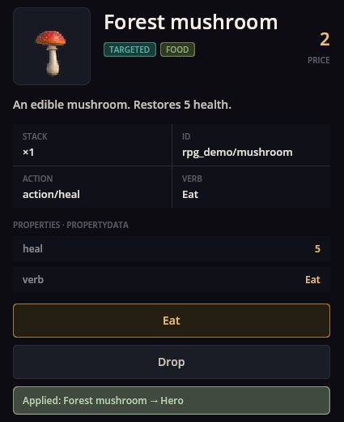

# Items Base — items, the inventory and using things

Items Base gives a game items and a bag to keep them in. It defines what an item is (name, picture, price, type and what happens when it is used), shows the **Inventory** panel, saves what the player carries, and lets scenarios give, take and check items. Trading, cooking, crafting, equipment and the RPG maps all build on it.

## The Inventory panel

Open it with the bag icon on the toolbar. Click an item on the left to see its details on the right.


- **Tabs** at the top filter by type (Food, Resources, Recipes, Quests); the search field and the sort list narrow the grid.
- **Details** show the name, type badges, price, description, stack size, id and the item's own properties.
- **The action button** is named by the item: **Use**, **Eat** for food, **Apply to target**, **Learn recipe**, or a verb the item defines (the mushroom says **Eat** because of its `verb`).
- **Targeted items** ask whom to use them on: pick a party member, or **Cancel**.
- **Drop** throws a stack away after a confirmation; key items cannot be dropped.
- In a battle every use or drop costs the active character one action point; outside battle it is free.



If an action cannot be done — for example the target already has full health — the item is not spent and the panel says why.

## An item definition

Items are JSON files of kind `item` in a mod's `items/` folder, with the picture next to them. This is the mushroom from the pictures above (from RPG Plus):

```json
{
  "Kind": "item",
  "Items": [
    {
      "Id": "rpg_plus/mushroom",
      "Name": "rpg_plus/item/mushroom/name",
      "Description": "rpg_plus/item/mushroom/desc",
      "Cost": 2,
      "Sprite": "rpg_plus/forest_mushroom",
      "ItemType": "Food,TargetUsed",
      "ItemAction": "action/heal",
      "heal": 5,
      "verb": "ui/inventory/verb_eat"
    }
  ]
}
```

- `Name`, `Description` — translation keys, shown in the details.
- `Cost` — the price, used by shops.
- `Sprite` — the picture `items/rpg_plus/forest_mushroom.png`.
- `ItemType` — one or more types, separated by commas: `Food`, `Resource`, `Quest`, `Recipe`, `Used` (used without a target), `TargetUsed` (used on a party member), `CantDrop`.
- `ItemAction` — what using it does. `action/heal` restores health by the item's `heal` value, never above the maximum and never to a fallen character. Other mods add actions, for example equipment's `action/equip`.
- Any other key (`heal`, `verb`) is an item property: actions read them, and the details list them. `verb` names the action button.

## Items in scenarios

```scenario
action item.add id=rpg_plus/mushroom count=2
when "item('rpg_plus/mushroom') >= 2" -> :enough
action item.remove id=rpg_plus/mushroom count=2
```

- `item.add` puts items into the bag (a chest, a gift, a pickup on a map); `count` defaults to 1.
- `item('id')` compares how many the player has; it works in `when`, in answer conditions, quests and map events.
- `item.remove` takes items away; it refuses when the player has fewer, so check with `item('id')` first.

## Recipes

Recipes (kind `recipe`) list `Input` and `Output` items with counts. This mod keeps which recipes the player knows; cooking and crafting use them.

## If something goes wrong

1. **An item shows its id instead of a name.** Add its `Name` key to the mod's `locale` files.
2. **No action button.** The item needs `Used` or `TargetUsed` in `ItemType` and an `ItemAction`.
3. **Using does nothing and the item stays.** The action refused: for healing, the target is at full health or has fallen.
4. **`item.add` adds nothing.** The id is unknown; check the `Id` in the item file.

## One inventory for groups and 3D occurrences

Ordinary groups and unique world occurrences share the same bag. Count checks sum
all accessible groups; crafting, trade and scenario removal use an atomic batch.
A full container refuses before spending ingredients, money or a world identity.
Equal blueprints do not make unique occurrences mergeable.

The inventory retains group IDs and the quantity supplied by each origin.
Splitting creates a child ID and keeps the remainder ID; merging preserves all
origin quantities. Recipe/deal receipts link new product origins to consumed
inputs. Individual properties must match before groups can merge.

A 3D occurrence keeps its world recipe and payload with scene3d. Consuming it
commits the bag removal and world tombstone together; loading cannot recreate its
authored source. Equipment transfers the selected identity into an equipment
compartment and returns that same identity on unequip. Missing providers preserve
inert data and refuse the affected operation.

## Rectangular storage

With **Items Editor** loaded, **Container size** sets columns and rows and arranges
the current bag. Both zero selects the legacy unlimited presentation. A smaller
container refuses if its contents cannot fit. The author can also set capacity
from a scenario: `action inventory.grid width=10 height=6`.

Drag a group to move it. Hold **R** during the drop to turn a rotatable item.
Drop onto a compatible group to merge; **Split group in half** creates a separate
group in free cells. Search/filter hides rows without freeing their occupied
cells. Sorting does not rearrange a bounded bag.

In **Items Editor**, configure item width/height, group width/height, the group
limit and rotation. Zero group dimensions inherit the single-item dimensions;
a group limit of one prevents grouping. Old item definitions default to 1x1
and unlimited group quantity. Cell dimensions are authored gameplay data, not
inferred from physical 3D bounds. Existing saved groups retain their saved rules.

Placement, shape, provenance and retry history live in the normal items save
slot. Legacy ID/count saves load into individual groups. A malformed modern
storage blob is rejected before replacing live state. Unknown definitions retain
their records and occupied cells until their provider returns.

### Developer contract

`InventoryStorage` validates detached candidates before publication. `TryAdd`,
`TryExchange`, `TryMove`, `TrySplit`, `TryMerge` and `TryConfigure` retain durable
operation receipts. Equal retries return the original result; changed requests
refuse. `CreatedOrigins` links product quantities to a receipt's `Removed`
inputs. There is a 16384-receipt budget with explicit refusal rather than eviction.

`Inventory.CaptureStorage` and `RestoreStorage` bridge the normal save owner;
`FindStack`/`StackId` preserve exact selection. `TrySplitStack` coordinates -1/-1
request automatic placement. `CanExchange` previews all inputs and outputs;
`TryExchange` commits them together. Legacy void `Add` logs refusal: conditional
reward owners should use `TryAdd` or `TryExchange` and inspect the result.

`IInventoryInstanceConsumptionOwner` prepares a domain participant whose silent
apply/rollback only swap preallocated managed state. All participants are checked
before the swap window; observers run after every owner commits. Scene3d retains
world tombstones and paired receipts. `IInventoryStackAction` owns its selected
transfer, preventing a second equal blueprint from being consumed by the panel.

The GUI fixture is inert without `--itest=inventory_storage_gui`; its runner
selector is `inventory_storage_gui`. Captures use `ViewportCapture`. This storage
does not add merchant buyback, nested-bag gameplay or distant world aggregation.
