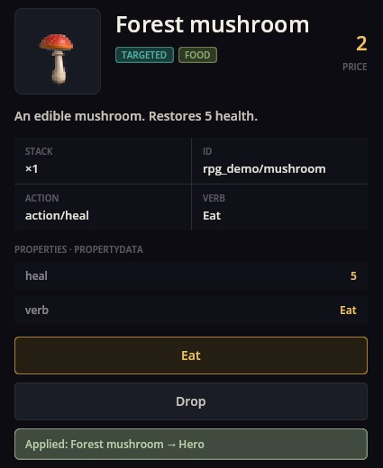

# Items Base — objetos, el inventario y su uso

Items Base da a un juego objetos y una bolsa donde guardarlos. Define qué es un objeto (nombre, imagen, precio, tipo y qué ocurre al usarlo), muestra el panel **Inventario**, guarda lo que lleva el jugador y deja que los escenarios den, quiten y comprueben objetos. El comercio, la cocina, la fabricación, el equipo y los mapas RPG se apoyan en él.

## El panel Inventario

Se abre con el icono de la bolsa en la barra de herramientas. Haz clic en un objeto de la izquierda para ver sus detalles a la derecha.


- **Pestañas** arriba filtran por tipo (Comida, Recursos, Recetas, Misiones); el campo de búsqueda y la lista de orden reducen la cuadrícula.
- **Detalles** muestran el nombre, los distintivos de tipo, el precio, la descripción, el tamaño de la pila, el id y las propiedades propias del objeto.
- **El botón de acción** lo nombra el propio objeto: **Usar**, **Comer** para la comida, **Aplicar a objetivo**, **Aprender receta**, o un verbo que el objeto define (la seta dice **Comer** por su `verb`).
- **Los objetos dirigidos** preguntan sobre quién usarlos: elige a un miembro del grupo o **Cancelar**.
- **Tirar** desecha una pila tras una confirmación; los objetos clave no se pueden tirar.
- En combate, cada uso o tirada cuesta al personaje activo un punto de acción; fuera de combate es gratis.



Si una acción no puede hacerse — por ejemplo, el objetivo ya tiene la salud llena —, el objeto no se gasta y el panel explica por qué.

## Una definición de objeto

Los objetos son archivos JSON de tipo `item` en la carpeta `items/` de un mod, con la imagen al lado. Esta es la seta de las imágenes de arriba (de RPG Demo):

```json
{
  "Kind": "item",
  "Items": [
    {
      "Id": "rpg_demo/mushroom",
      "Name": "rpg_demo/item/mushroom/name",
      "Description": "rpg_demo/item/mushroom/desc",
      "Cost": 2,
      "Sprite": "rpg_demo/forest_mushroom",
      "ItemType": "Food,TargetUsed",
      "ItemAction": "action/heal",
      "heal": 5,
      "verb": "ui/inventory/verb_eat"
    }
  ]
}
```

- `Name`, `Description` — claves de traducción, mostradas en los detalles.
- `Cost` — el precio, que usan las tiendas.
- `Sprite` — la imagen `items/rpg_demo/forest_mushroom.png`.
- `ItemType` — uno o más tipos, separados por comas: `Food`, `Resource`, `Quest`, `Recipe`, `Used` (se usa sin objetivo), `TargetUsed` (se usa sobre un miembro del grupo), `CantDrop`.
- `ItemAction` — qué hace al usarse. `action/heal` restaura salud según el valor `heal` del objeto, sin pasar del máximo y nunca sobre un caído. Otros mods añaden acciones, por ejemplo el `action/equip` de equipment.
- Cualquier otra clave (`heal`, `verb`) es una propiedad del objeto: las acciones la leen y los detalles la enumeran. `verb` nombra el botón de acción.

## Objetos en escenarios

```scenario
action item.add id=rpg_demo/mushroom count=2
when "item('rpg_demo/mushroom') >= 2" -> :enough
action item.remove id=rpg_demo/mushroom count=2
```

- `item.add` mete objetos en la bolsa (un cofre, un regalo, una recogida en el mapa); `count` vale 1 por defecto.
- `item('id')` compara cuántos lleva el jugador; funciona en `when`, en condiciones de respuesta, en misiones y en eventos de mapa.
- `item.remove` quita objetos; se niega si el jugador tiene menos, así que comprueba antes con `item('id')`.

## Recetas

Las recetas (tipo `recipe`) enumeran objetos de `Input` y `Output` con cantidades. Este mod recuerda qué recetas conoce el jugador; la cocina y la fabricación las usan.

## Si algo falla

1. **Un objeto muestra su id en vez de un nombre.** Añade su clave `Name` a los archivos `locale` del mod.
2. **No hay botón de acción.** El objeto necesita `Used` o `TargetUsed` en `ItemType` y un `ItemAction`.
3. **Usar no hace nada y el objeto se queda.** La acción se negó: al curar, el objetivo está con la salud llena o ha caído.
4. **`item.add` no añade nada.** El id es desconocido; comprueba el `Id` en el archivo del objeto.
