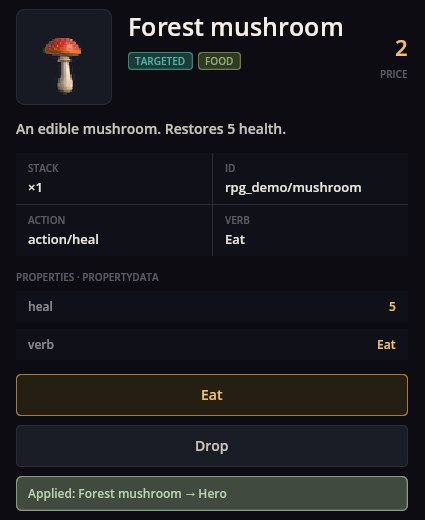

# Items Base — предметы, инвентарь и то, как их применять

Items Base даёт игре предметы и сумку, чтобы их носить. Мод определяет, что такое предмет (имя, картинка, цена, тип и что происходит при использовании), показывает панель **Инвентарь**, сохраняет то, что несёт игрок, и позволяет сценариям выдавать, забирать и проверять предметы. Торговля, готовка, крафт, экипировка и RPG-карты строятся на нём.

## Панель инвентаря

Открывается иконкой сумки на панели инструментов. Щёлкните предмет слева, чтобы справа увидеть его подробности.


- **Вкладки** сверху фильтруют по типу (Еда, Ресурсы, Рецепты, Задания); поле поиска и список сортировки сужают сетку.
- **Подробности** показывают имя, метки типа, цену, описание, размер стопки, id и собственные свойства предмета.
- **Кнопка действия** названа самим предметом: **Использовать**, **Съесть** для еды, **Применить к цели**, **Выучить рецепт** — или тем глаголом, который предмет задаёт (гриб говорит **Съесть** из-за своего `verb`).
- **Направляемые предметы** спрашивают, на кого их применить: выберите члена отряда или **Отмена**.
- **Выбросить** спрашивает количество. В 3D-игре настроенный обработчик размещает группу на земле; в прежнем 2D-режиме количество удаляется после подтверждения. Ключевые предметы выбросить нельзя.
- В прежнем 2D-бою успешное использование или выбрасывание стоит активному персонажу одно очко действия; отказ не тратит очки. 3D-обработчик применяет условия своей игровой механики.



Если действие невозможно — например, у цели уже полное здоровье, — предмет не тратится, а панель объясняет почему.

## Описание предмета

Предметы — это JSON-файлы вида `item` в папке `items/` мода, рядом с ними лежит картинка. Вот гриб с картинок выше (из RPG Plus):

```json
{
  "Kind": "item",
  "Items": [
    {
      "Id": "rpg_plus/mushroom",
      "Name": "rpg_plus/item/mushroom/name",
      "Description": "rpg_plus/item/mushroom/desc",
      "Cost": 2,
      "Sprite": "rpg_plus/forest_mushroom",
      "ItemType": "Food,TargetUsed",
      "ItemAction": "action/heal",
      "heal": 5,
      "verb": "ui/inventory/verb_eat"
    }
  ]
}
```

- `Name`, `Description` — ключи перевода, показываются в подробностях.
- `Cost` — цена; её используют магазины.
- `Sprite` — картинка `items/rpg_plus/forest_mushroom.png`.
- `ItemType` — один или несколько типов через запятую: `Food`, `Resource`, `Quest`, `Recipe`, `Used` (применяется без цели), `TargetUsed` (применяется к члену отряда), `CantDrop`.
- `ItemAction` — что делает применение. `action/heal` восстанавливает здоровье на значение `heal` предмета — не выше максимума и никогда не поднимает упавшего. Другие моды добавляют свои действия, например `action/equip` экипировки.
- Любой другой ключ (`heal`, `verb`) — свойство предмета: действия его читают, а подробности его показывают. `verb` называет кнопку действия.

## Предметы в сценариях

```scenario
action item.add id=rpg_plus/mushroom count=2
when "item('rpg_plus/mushroom') >= 2" -> :enough
action item.remove id=rpg_plus/mushroom count=2
```

- `item.add` кладёт предметы в сумку (сундук, подарок, подбор на карте); `count` по умолчанию равен 1.
- `item('id')` сравнивает, сколько предметов у игрока; работает в `when`, в условиях ответов, в заданиях и событиях карты.
- `item.remove` забирает предметы; если их меньше, отказывается — поэтому сначала проверьте через `item('id')`.

## Рецепты

Рецепты (вид `recipe`) перечисляют предметы `Input` и `Output` с количествами. Этот мод хранит, какие рецепты игрок уже знает; готовка и крафт пользуются ими.

## Если что-то пошло не так

1. **Предмет показывает id вместо имени.** Добавьте его ключ `Name` в файлы `locale` мода.
2. **Нет кнопки действия.** Предмету нужен тип `Used` или `TargetUsed` в `ItemType` и `ItemAction`.
3. **Применение ничего не делает, а предмет остаётся.** Действие отказало: для лечения цель либо при полном здоровье, либо упала.
4. **`item.add` ничего не добавляет.** Идентификатор неизвестен; сверьте `Id` в файле предмета.

## Единый инвентарь и сетка

Обычные группы и уникальные предметы из 3D-мира находятся в одном инвентаре.
Проверка количества суммирует доступные группы. Ремесло, торговля и списание
сценарием проверяют всю операцию до изменения вещей: нехватка места не расходует
деньги или ингредиенты. Уникальные экземпляры не объединяются даже при одинаковом
типе предмета.

При разделении остаток сохраняет свой ID, отделённая группа получает новый ID и
ссылку на родителя. Объединение сохраняет количество от каждого источника.
Квитанции ремесла и сделок связывают происхождение результата с потраченными
предметами. Группы с различными индивидуальными свойствами не объединяются.

Расходование 3D-экземпляра одновременно убирает его из сумки и оставляет запись
удаления у владельца мира. После загрузки исходный предмет не появляется снова.
Экипировка переносит выбранный экземпляр в свой отсек и возвращает тот же ID при
снятии. Недоступный владелец сохраняет данные и запрещает затронутую операцию.

При загруженном редакторе предметов кнопка **Размер контейнера** задаёт число
столбцов и строк и раскладывает содержимое. Два нуля оставляют прежний режим без
ограничений. Уменьшение отклоняется, если вещи не помещаются. Автор сценария также
может задать размер: `action inventory.grid width=10 height=6`.

Предметы перетаскиваются по ячейкам. При отпускании удерживайте **R** для поворота
разрешённого предмета. Перенос на совместимую группу объединяет их; **Разделить
группу пополам** создаёт новую группу в свободных ячейках. Скрытые поиском предметы
продолжают занимать место. Сортировка не меняет укладку ограниченной сетки.

В редакторе предметов доступны ширина и высота предмета, размеры группы, предел
количества и разрешение поворота. Нулевой размер группы наследует размер предмета;
предел 1 запрещает объединение. Для прежних определений по умолчанию используются
1×1 и группы без ограничения количества. Размеры в ячейках задаёт автор: они не
вычисляются по геометрии 3D-модели. Уже сохранённая группа сохраняет свои правила.

Положение, размеры, происхождение и история операций входят в обычное сохранение
предметов. Старые сохранения ID/количество преобразуются в группы. Повреждённые
данные новой сетки отклоняются до замены состояния. Отсутствующее определение не
удаляет предмет и занятые им ячейки.

## Профиль инвентаря для отдельной игры

Тип инвентаря выбирается игрой, а не камерой или 3D-миром. В её
`collection.json` укажите настройку (тот же выбор доступен в редакторе сборки):

```json
"settings": { "inventory.profile": "inventory/grid" }
```

В `items_base` поставляются три профиля:

| ID | Правила и вид |
| --- | --- |
| `inventory/grid` | Сетка 10×6: предметы и группы занимают прямоугольники своих размеров. |
| `inventory/slots` | Одинаковые ячейки без лимита: одна группа занимает одну ячейку независимо от физических размеров. |
| `inventory/list` | Список строк с названием и количеством, без геометрического ограничения. |

Размер группы, лимит объединения, свойства, уникальность и происхождение едины
во всех режимах. Перевод большого предмета в слоты не переписывает его размеры:
после возврата в сетку снова используется исходный прямоугольник. В слотовом
профиле можно задать конечное число ячеек, например 8×4. Пустая настройка сохраняет
прежнюю безлимитную сумку; игрок не выбирает более вместительный режим через обычную
панель. Форма смены вида доступна только с модом `items_editor`.

Свой профиль добавляется обычным JSON в мод, зависящий от `items_base`:

```json
{
  "Kind": "inventory_profile",
  "Items": [
    { "Id": "my_game/bag", "Extends": "inventory/slots", "Width": 8, "Height": 4 }
  ]
}
```

Затем игра выбирает `"inventory.profile": "my_game/bag"`. Поддерживаются
стандартные `Extends`, переопределение по ID и `patches/inventory_profile.json`.
Мод может добавить свой вариант в `options` файла `collection_settings.json`
с ключом `inventory.profile`; произвольный ID можно ввести и вручную.
Сущности профилей читаются из текущего набора модов, выбор не кэшируется между играми.
Неизвестный или некорректный явно выбранный профиль останавливает создание новой
сумки, чтобы ошибочная сборка не получила незаметно безлимитную вместимость.

Новая игра берёт профиль из сборки. Сохранение хранит уже выбранный вид,
вместимость, размещение и предметы: изменение настроек сборки не перепаковывает
старое сохранение автоматически. Для явной смены существующей сумки используйте
`inventory.profile id=my_game/bag` в сценарии или
`InventoryProfiles.TryApply(inventory, operationId, profileId, out reason)`.
Вместимость проверяется до изменения, переполнение отменяет всю смену. Команда
`inventory.grid width=8 height=4 layout=slots` задаёт произвольные размеры напрямую;
`layout` по умолчанию `grid`. Для `list` обе размерности должны быть нулевыми.

Все режимы используют один `IInventory`: крафт, торговля, экипировка и 3D-перенос
не зависят от вида панели. Собственный интерфейс мода может заменить UI-регистрацию
`inventory` или патчить сцену, продолжая работать с теми же группами и операциями.

### Резервное владение количеством

Доменные адаптеры могут передать обычную группу в резервный контейнер через
`TryPrepareCustodyTransfer`. Такая группа сохраняется владельцем `items_base`,
но не входит в доступную сумку и не расходуется обычным крафтом или торговлей.
Положительная часть получает дочерний ID, остаток сохраняет ID; при возврате
проверяются вместимость и совместимость групп, сохраняется вклад каждого источника.
Квитанция фиксирует внешнюю ссылку и точные количества. Подготовленный участник
не меняет состояние: координатор проверяет обоих владельцев, применяет оба
изменения и только затем публикует события. Это внутренний контракт адаптеров,
а не дополнительный безлимитный карман игрока.

Обычное выбрасывание поддерживает модовые `IInventoryGroupDropHandler`: обработчик выбирает действующий игровой домен, проверяет разрешение и переносит выбранное количество. Подтверждение привязано к текущей сумке, полным данным группы и поколению поставщика. Отсутствующий после подтверждения или неготовый 3D-поставщик не превращает перенос в удаление. Настройка мирового представления описана в [scene3d_base](../../../mods_private/scene3d_base/docs/ru.md).
