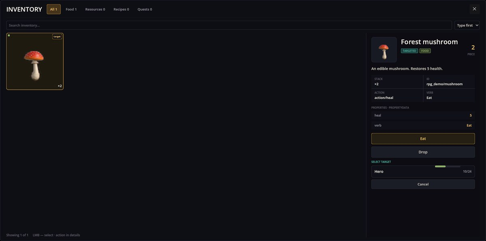

# Items Base — 物品、背包与物品的使用

Items Base 为游戏提供物品和装物品的背包。它定义物品是什么（名称、图片、价格、类型，以及使用时会发生什么），显示**背包**面板，保存玩家携带的东西，并让剧本能够发放、移除和检查物品。交易、烹饪、合成、装备和 RPG 地图都构建在它之上。

## 背包面板

用工具栏上的背包图标打开。点击左侧的物品，右侧会显示它的详情。



- 顶部的**页签**按类型筛选（食物、资源、配方、任务）；搜索框和排序列表可以缩小网格范围。
- **详情**显示名称、类型徽章、价格、描述、堆叠上限、id 和物品自身的属性。
- **动作按钮**由物品自己命名：**使用**、食物显示**吃**、**对目标使用**、**学习配方**，或者物品自定义的动词（蘑菇因为带 `verb` 而显示**吃**）。
- **定向物品**会询问用在谁身上：选择一名队伍成员，或者**取消**。
- **丢弃**会在确认后扔掉一整堆；关键物品无法丢弃。
- 战斗中，每次使用或丢弃都要花掉当前角色一点行动点；战斗之外则免费。


如果动作无法执行——比如目标生命值已满——物品不会被消耗，面板会说明原因。

## 物品的定义

物品是 mod 的 `items/` 文件夹里类型为 `item` 的 JSON 文件，图片就放在旁边。这是上面截图中的蘑菇（来自 RPG Demo）：

```json
{
  "Kind": "item",
  "Items": [
    {
      "Id": "rpg_demo/mushroom",
      "Name": "rpg_demo/item/mushroom/name",
      "Description": "rpg_demo/item/mushroom/desc",
      "Cost": 2,
      "Sprite": "rpg_demo/forest_mushroom",
      "ItemType": "Food,TargetUsed",
      "ItemAction": "action/heal",
      "heal": 5,
      "verb": "ui/inventory/verb_eat"
    }
  ]
}
```

- `Name`、`Description` — 翻译键，显示在详情里。
- `Cost` — 价格，商店会用到。
- `Sprite` — 图片 `items/rpg_demo/forest_mushroom.png`。
- `ItemType` — 一个或多个类型，用逗号分隔：`Food`、`Resource`、`Quest`、`Recipe`、`Used`（无需目标直接使用）、`TargetUsed`（对队伍成员使用）、`CantDrop`。
- `ItemAction` — 使用时做什么。`action/heal` 按物品的 `heal` 值恢复生命值，不会超过上限，也绝不会作用于倒下的角色。其他 mod 会添加自己的动作，例如装备的 `action/equip`。
- 其余任何键（`heal`、`verb`）都是物品属性：动作读取它们，详情也会列出。`verb` 决定动作按钮的名字。

## 剧本中的物品

```scenario
action item.add id=rpg_demo/mushroom count=2
when "item('rpg_demo/mushroom') >= 2" -> :enough
action item.remove id=rpg_demo/mushroom count=2
```

- `item.add` 把物品放进背包（宝箱、礼物、地图上的拾取物）；`count` 默认为 1。
- `item('id')` 比较玩家拥有多少个；可用于 `when`、选项条件、任务和地图事件。
- `item.remove` 移除物品；数量不足时会拒绝执行，所以请先用 `item('id')` 检查。

## 配方

配方（类型 `recipe`）列出 `Input` 和 `Output` 物品及数量。本 mod 负责记住玩家已学会哪些配方；烹饪和合成都会用到它们。

## 出问题时

1. **物品显示的是 id 而不是名字。** 把它的 `Name` 键加进 mod 的 `locale` 文件。
2. **没有动作按钮。** 物品需要在 `ItemType` 里带 `Used` 或 `TargetUsed`，并且设置 `ItemAction`。
3. **使用没有效果，物品也没消耗。** 动作拒绝了：治疗时目标生命值已满或已倒下。
4. **`item.add` 什么都没加。** id 未知；核对物品文件里的 `Id`。
